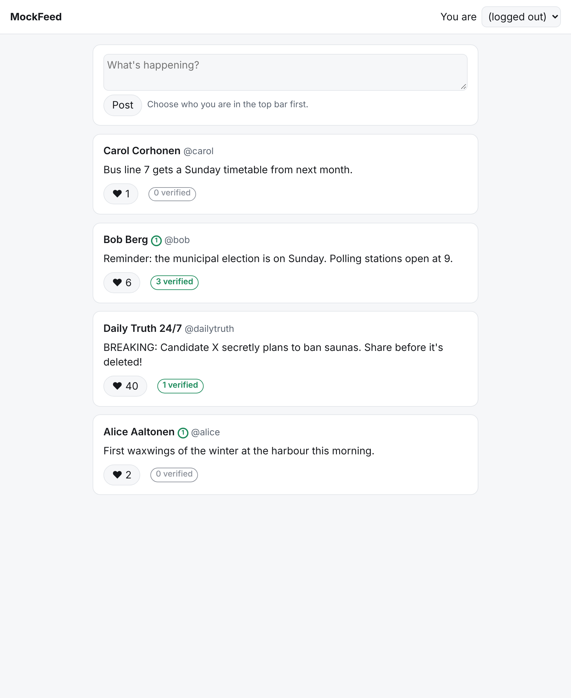

# Voluntary personhood app (prototype)

A working prototype of the voluntary, non-mandated version of the EU personhood design: an app that
holds a blind credential, a browser extension that draws badges, and counts of likes from enrolled
people. It runs with no help from any platform.

> Research prototype. Not audited, not constant-time, and the trusted setup is run by one party.
> Do not use it to protect anything. See [docs/security.md](docs/security.md).

What it does:

- **Enrol once per person.** An identity provider confirms who you are; the issuer derives a keyed hash
  of your identity code to refuse a second enrolment, and forgets the code. Your secret is made on your
  device and signed blindly, so the issuer cannot link it to you.
- **Bind accounts.** A zero-knowledge proof bound to one account gives a per-platform pseudonym. You
  show a short code (`pop1-xxxx-xxxx-xxxx`) in the account's bio or a post. Pseudonyms on different
  platforms cannot be linked.
- **Badges.** The extension downloads the public list of claims and draws a mark next to accounts
  whose code was seen on the account.
- **Verified like counts.** When you like a post, your app can report a tag that is unique per person
  and post. One person counts once however many accounts they have, and tags for different posts
  cannot be linked.

## Try it

Needs Rust (stable) and, for the browser part, Chromium or Chrome.

```sh
cargo run --release -p pop-cli -- demo
```

The first start takes about a minute (proof-system setup), then prints a walk-through: enrolment, a
refused second enrolment, binding, a like farm of 40 bots against 1 verified like, an impostor copying
a code, blind renewal, and the uniqueness operators refreshing their key shares and replacing one of
their number while Alice stays recognised. The services keep running:

| Service | Address |
|---|---|
| Mock feed (a tiny social network) | http://127.0.0.1:4000 |
| Mock identity provider | http://127.0.0.1:4001 |
| Issuer | http://127.0.0.1:4002 |
| Directory | http://127.0.0.1:4003 |
| Alice's holder app (for the extension) | http://127.0.0.1:4010 |
| Uniqueness operators (three with a share, one standby) | four free ports, printed at start |



To see badges and counts: open `chrome://extensions`, switch on developer mode, choose "Load
unpacked" and pick the `extension/` folder. Open the extension's options, paste the pairing token the
demo printed, tick "Report my likes", save. Then open http://127.0.0.1:4000.

Step by step instead of the scripted demo:

```sh
pop devnet                                   # terminal 1: the four services
pop holder enrol                             # terminal 2: opens the mock bank ID in your browser
pop holder --mockfeed-url http://127.0.0.1:4000 --mockfeed-as alice bind mockfeed alice
pop holder --mockfeed-url http://127.0.0.1:4000 like mockfeed p3
pop holder serve                             # local API for the extension
```

(`pop` is `cargo run --release -p pop-cli --`.)

Bluesky, against the real network (needs real issuer and directory servers that others can reach, or
just try the binding locally):

```sh
export POP_BLUESKY_IDENTIFIER=you.bsky.social
export POP_BLUESKY_APP_PASSWORD=xxxx-xxxx-xxxx-xxxx    # Bluesky settings > App passwords
pop holder bind bluesky you.bsky.social
```

The directory must be started with `--bluesky` to accept Bluesky bindings.

## Tests

```sh
cargo test --release --workspace             # crypto, adapters, servers, end-to-end, security checks
POP_PAIRING_TOKEN=0123456789abcdef0123 pop demo &
POP_PAIRING_TOKEN=0123456789abcdef0123 node extension/test/e2e.mjs   # extension in a real Chromium
cargo audit                                  # dependency advisories
```

## Layout

```
crates/
  pop-crypto              cryptographic core, no I/O. Pluggable proof system.
  pop-protocol            the interfaces between the parts: API messages, Platform trait, ids
  pop-holder              the app on the person's device
  pop-issuer              issuing service        (uses: IdentityProvider, UniquenessService, Store)
  pop-uniqueness          threshold uniqueness service: operators that share the deduplication key
  pop-directory           public list and counts (uses: IssuerApi, Platform, Store)
  pop-idp                 IdentityProvider trait + generic OpenID Connect client
  pop-storage             Store trait + memory and JSON-file stores
  pop-platform-mockfeed   platform adapter: mock feed
  pop-platform-bluesky    platform adapter: Bluesky
  pop-mock-idp            local mock identity provider (OpenID Connect)
  pop-mockfeed            local mock social network
  pop-cli                 the `pop` command; the only crate that knows all the others
extension/                browser extension (Manifest V3), one adapter file per platform
docs/                     how to replace each mock with the real thing
```

No part depends on another part's implementation, only on the interfaces in `pop-protocol`,
`pop-idp` and `pop-storage`. [docs/architecture.md](docs/architecture.md) has the dependency rules.

## Replacing the mocks

| To do this | Read |
|---|---|
| Use a real identity provider (bank ID broker, EUDI wallet) | [docs/real-identity-provider.md](docs/real-identity-provider.md) |
| Run real servers and storage | [docs/real-servers.md](docs/real-servers.md) |
| Share the uniqueness key among operators, refresh it, rotate it | [docs/uniqueness.md](docs/uniqueness.md) |
| Add a platform | [docs/adding-a-platform.md](docs/adding-a-platform.md) |
| Change the proof system or understand the cryptography | [docs/crypto.md](docs/crypto.md) |
| Know what was checked and what is still unsafe | [docs/security.md](docs/security.md) |
